# Architecture

A developer's map of the Parkinson's Detection App — what the pieces are, how a
test travels from a camera frame to a doctor's screen, and where to plug in new
work.

> **What this app is.** A screening aid, not a diagnostic tool. Every score it
> produces is provisional and uncalibrated. The camera test follows the
> MDS-UPDRS Part III hand protocol so recordings are *comparable* with the
> clinical examination, but the app does not produce an MDS-UPDRS score.

**Contents**

1. [System context](#1-system-context)
2. [Layer map](#2-layer-map)
3. [Bootstrap and navigation](#3-bootstrap-and-navigation)
4. [The test pipeline](#4-the-test-pipeline)
5. [Test-type registry](#5-test-type-registry)
6. [Camera test deep-dive](#6-camera-test-deep-dive)
7. [Data model](#7-data-model)
8. [Security model](#8-security-model)
9. [Doctor and scheduling](#9-doctor-and-scheduling)
10. [Design system and accessibility](#10-design-system-and-accessibility)
11. [Testing, and how to add a test type](#11-testing-and-how-to-add-a-test-type)

---

## 1. System context

Three kinds of person use the app, and it depends on five external systems —
two of them on-device.

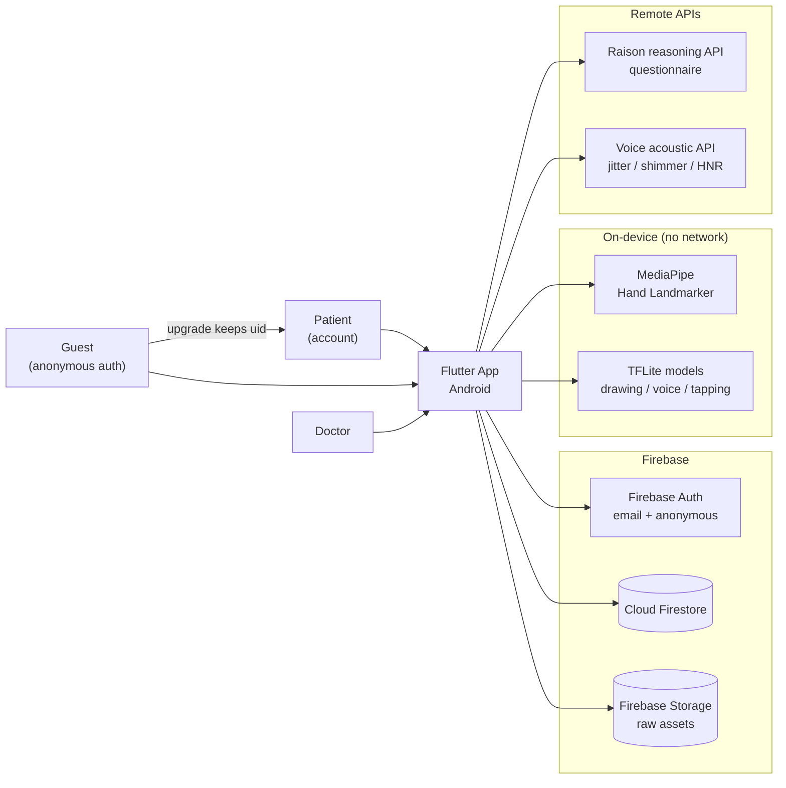

**Guest mode** is worth understanding early. A guest gets a real Firebase uid
via `signInAnonymously()`, so every `users/{uid}/…` path and every security rule
works unchanged — only the UI gates features. Upgrading calls
`linkWithCredential`, *not* `createUserWithEmailAndPassword`, so the uid survives
and no test history is orphaned. See
[`AuthenticationService.linkAnonymousToEmail`](lib/services/authentication_service.dart).

**Storage is write-mostly.** The app uploads raw assets but never reads them back
except a patient's own drawing; backend analysis jobs use the Admin SDK, which
bypasses Storage rules entirely.

---

## 2. Layer map

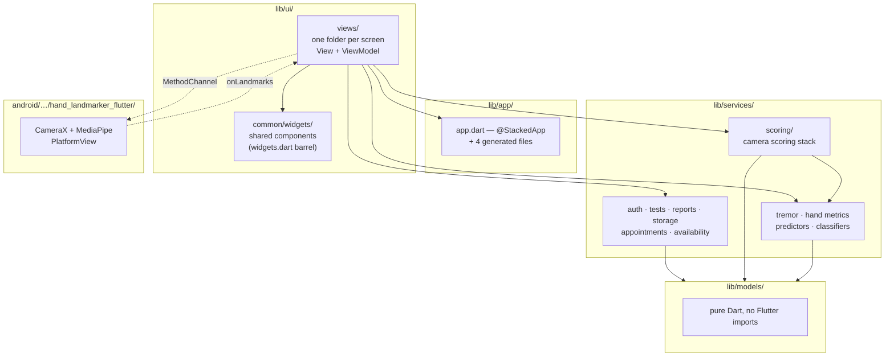

**The dependency rule:** `ui → services → models`, never upward. Models are pure
Dart and import no Flutter. Services never import a View.

Three separations are deliberate and enforced by structure rather than
convention — each is documented at its own definition:

| Separation | Where | Why |
|---|---|---|
| `LandmarkParser` split from `HandMetrics` | [landmark_parser.dart:5-11](lib/services/landmark_parser.dart#L5-L11) | So the camera preview can decode a frame without being able to reach the scoring helpers. |
| Preview renders no metrics | [hand_landmarker_screen.dart:15-32](lib/ui/views/patience/hand_landmarker_screen.dart#L15-L32) | An earlier version ran four 21-landmark metric passes per frame on the UI thread and drew a symptom verdict over the live preview. It cost capture rate — which is what the real analysis depends on — and showed the patient a diagnosis-shaped result mid-task. |
| `RecordedTask` vs `CameraTaskSegment` | [camera_recording.dart:8-16](lib/services/scoring/camera_recording.dart#L8-L16) | One type is about *analysis*, the other about *recording and upload*. Keeping them apart is what lets a scorer be tested against synthetic input with no Firebase in sight. |

---

## 3. Bootstrap and navigation

### Startup sequence

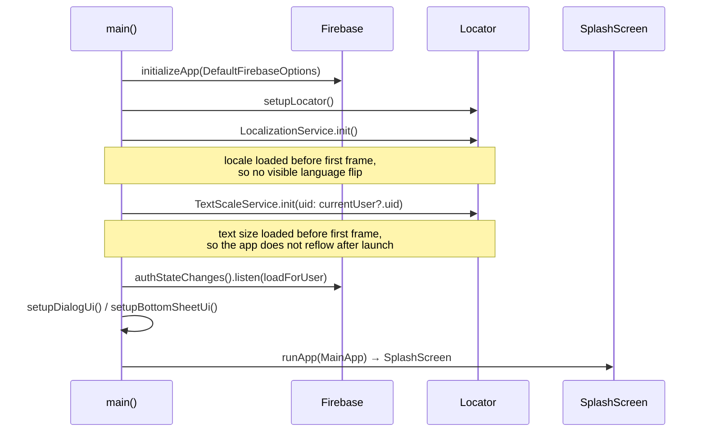

### Where you land

`SplashScreen._resolveTarget()`
([main.dart:147-201](lib/main.dart#L147-L201)) decides the first real screen.

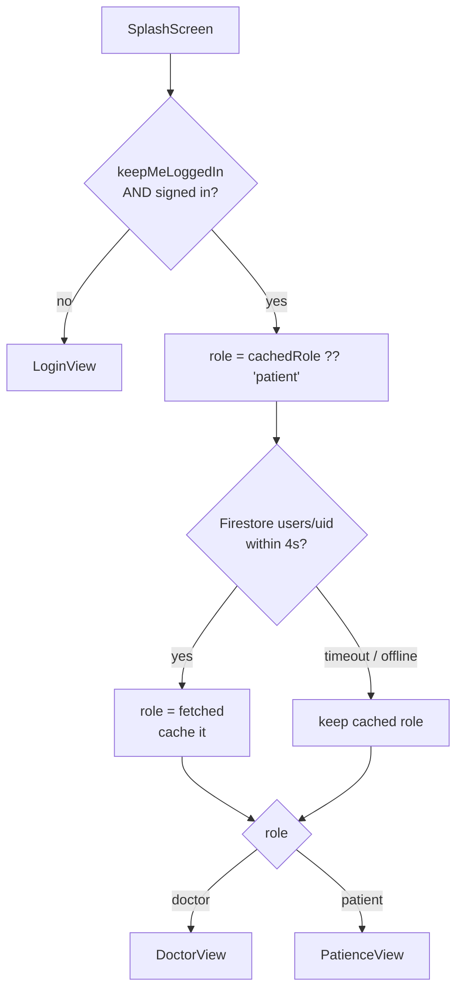

Two rules encoded here: a slow network must never ask a signed-in user to sign in
again, and the cached role must let a launch route correctly while fully offline.
The 350 ms minimum splash runs *concurrently* with this work, not added to it.

### Stacked wiring — generated files

[`lib/app/app.dart`](lib/app/app.dart) is the single source of truth. It declares
**16 routes** and **16 lazy singletons** under `@StackedApp`.

```
lib/app/app.dart                ← EDIT THIS
├── app.locator.dart            ← generated
├── app.router.dart             ← generated
├── app.dialogs.dart            ← generated
└── app.bottomsheets.dart       ← generated
```

Never hand-edit the four generated files. After changing `app.dart`:

```bash
dart run build_runner build --delete-conflicting-outputs
```

The registered singletons are: `BottomSheetService`, `DialogService`,
`NavigationService`, `AuthenticationService`, `TestService`, `ReportsService`,
`AppointmentService`, `AvailabilityService`, `VoiceApiService`,
`RaisonApiService`, `HandMetrics`, `TremorAnalysisService`,
`StorageService`, `LocalizationService`,
`TextScaleService`.

Note that not everything is in the locator — `DrawingPredictor`,
`VoicePredictor` and `TappingPredictor` are constructed directly by the view
models that use them, since each owns a TFLite interpreter with its own
lifetime.

### Two root-level rebuild drivers

`LocalizationService` and `TextScaleService` are both `ChangeNotifier`s, merged
into a single `AnimatedBuilder` at [main.dart:63-64](lib/main.dart#L63-L64)
because both invalidate the same subtree.

The `textScaler` override sits inside `MaterialApp.builder`, **not** above
`MaterialApp` ([main.dart:82-89](lib/main.dart#L82-L89)). `MediaQuery.of`
depends on the whole `MediaQueryData`, so an override higher up would rebuild the
entire `Navigator` every time the keyboard animates — which this app does
constantly, across the login form, both profile tabs and every speech-driven test
step.

---

## 4. The test pipeline

Every one of the nine tests follows the same spine.

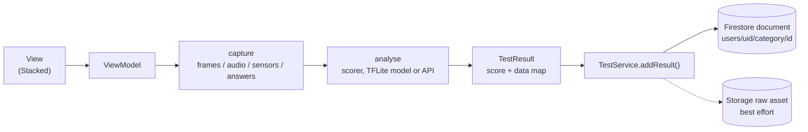

### The write ordering matters

[`TestService.addResult`](lib/services/test_service.dart#L117-L155) writes the
**Firestore document first**, then uploads raw assets, and never lets an upload
failure propagate.

This was deliberately reversed from the obvious order. Uploading first avoids
documents that point at assets which were never stored — but it trades the wrong
way: a single Storage error (denied rules, no network, app killed mid-upload)
meant the write was never reached and the whole test silently vanished.

> A result without its raw blob is still a usable result. A blob with no document
> is invisible to the app entirely.

When an upload does fail, the document is marked `rawDataUploaded: false` plus
the error, so a reviewer can distinguish "no raw data" from "raw data not yet
fetched". Absence of the field means there was nothing to upload, or it uploaded
cleanly.

`isGuest` is stamped on at serialisation time in `_toJsonWithGuestFlag`, applied
in one place rather than at the ten call sites, and stored top-level rather than
inside `data` — which each test replaces wholesale.

---

## 5. Test-type registry

The most useful table in this document. One row per `TestType`.

| `TestType` | View / ViewModel | Firestore subcollection | Storage category | Analysis engine |
|---|---|---|---|---|
| `cameraDetection` | [camera_test](lib/ui/views/camera_test/) | `camera` | `cameraDetection` | `MotorRatingScorer` — 0-4 item ratings |
| `drawing` | [drawing_test](lib/ui/views/drawing_test/) | `drawing` | `drawing` | `DrawingPredictor` (TFLite, 256×256 grayscale) |
| `voice` | [voice_test](lib/ui/views/voice_test/) | `voice` | `voice` | `VoicePredictor` (TFLite, 16 features) + `VoiceApiService` |
| `tremor` | [tremor_test](lib/ui/views/tremor_test/) | `tremor` | `tremor` | `TremorAnalysisService` (FFT via `fftea`) |
| `tap` | [tap_test](lib/ui/views/tap_test/) | `tapping` | `tap` | `TappingPredictor` (TFLite, 7 features) |
| `posture` | [posture_test](lib/ui/views/posture_test/) | `posture` | — | `HandPostureClassifier` |
| `questionnaire` | [questionnaire](lib/ui/views/questionnaire/) | `questionnaire` | — | `RaisonApiService` |
| `neuro` | [neuro_test](lib/ui/views/neuro_test/) | `neuropsychological` | — | in-viewmodel, MoCA-style |
| `fab` | [fab_test](lib/ui/views/fab_test/) | `FAB` | — | in-viewmodel, 5 of 6 FAB items |

### ⚠ The naming mismatch

**Three different names can refer to the same test**, and getting one wrong fails
silently. This is the single most likely bug when adding or renaming a test type.

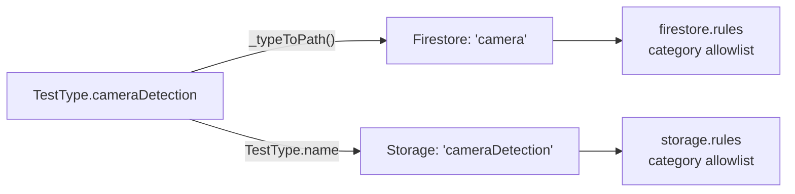

Two live examples:

- **`cameraDetection`** → Firestore subcollection `camera`, but Storage category
  `cameraDetection`. The Firestore path comes from
  [`_typeToPath`](lib/services/test_service.dart#L278-L299); the Storage path
  comes from `TestType.name`. The two lists are not interchangeable, and
  [`storage.rules`](storage.rules) says so in a comment.
- **`fab`** → `FAB`, with capitals. [`firestore.rules`](firestore.rules) must
  carry the string with matching case in its `category in [...]` allowlist.
  Without it, *every FAB score is denied and silently discarded* — which is
  exactly what happened, and why the rule now carries a comment pinning it to
  `TestService._typeToPath`.

**Four lists must agree at all times:** `_typeToPath`, `_uploadRawData`, the
Firestore rules allowlist, and the Storage rules allowlist.

---

## 6. Camera test deep-dive

A hands-free, landscape test: the phone is propped on its side about 50-70 cm
away, both hands in view, and after one tap on Start every step counts down,
records and moves on by itself, with spoken cues.

### Native → Dart bridge

```mermaid
sequenceDiagram
    participant CX as CameraX
    participant H as HandLandmarkerHelper
    participant O as OverlayView
    participant CH as MethodChannel
    participant P as LandmarkParser
    participant VM as CameraTestViewModel

    CX->>H: frame (LIVE_STREAM, 640x480, AE fps range pinned high)
    H->>H: mirror + rotate, MediaPipe detect (GPU, CPU fallback)
    H->>O: setResults() — draws skeleton
    H->>CH: invokeMethod("onLandmarks", {timestampMs, hands})
    Note over CH: timestampMs = capture time;<br/>hands: landmarks, handedness, handednessScore
    CH->>P: parseFrame(raw)
    P->>VM: FrameData / LandmarkData
    VM->>VM: assign hands by position, append to task segment
```

[`HandLandmarkerHelper`](android/app/src/main/kotlin/com/example/hand_landmarker_flutter/HandLandmarkerHelper.kt)
runs MediaPipe on the GPU delegate and falls back to the CPU if it cannot start
or keeps failing. It asks the front camera for its highest frame-rate range
(auto-exposure otherwise drops to 15 fps indoors), follows display rotation so
landscape frames reach the detector upright, and handles padded camera rows.
Each frame is sent with its capture time so the analysis is not measuring
platform-channel jitter.

**Handedness.** MediaPipe assumes a mirrored, selfie-style input and gets one,
so its label is passed through unchanged (it used to be flipped a second time).
The camera test does not rely on it anyway:
[`HandAssignment`](lib/services/tracking_classifier.dart) tells hands apart by
position — in the mirrored picture the user's right hand is on the right. The
posture test re-applies the old flip locally so its tuned geometry is unchanged.
`LandmarkParser` keeps every hand, including two with the same label.

### The protocol

[`CameraTaskProtocol`](lib/models/camera_task_protocol.dart), 8 steps of 10 s:

| Step | Hands | MDS-UPDRS item | Analysed as |
|---|---|---|---|
| `rest` | both | 3.17 rest tremor | tremor |
| `posture` | both | 3.15 postural tremor | tremor |
| `fingerTap` | right, then left | 3.4 | cycles |
| `openClose` | right, then left | 3.5 | cycles |
| `pronationSupination` | right, then left | 3.6 | cycles |

Each step has a spoken countdown (8 s for the first step and each change of
hand, 5 s otherwise) that holds while the needed hands are out of view. A step
that fails `TaskQualityValidator` is repeated once automatically, then kept.

### View model state machine

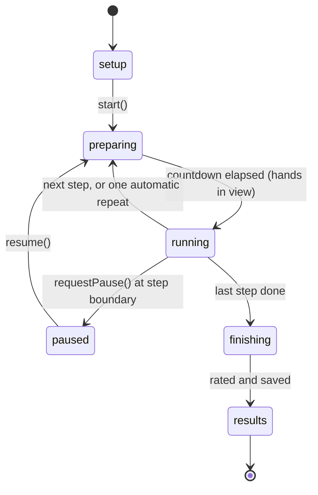

The setup phase shows live checks: hands in view, too far / too close (from
palm size in the picture) and measured frames per second.

### Scoring: 0-4 item ratings

[`MotorRatingScorer`](lib/services/scoring/motor_rating.dart) rates every step
that passed the quality check, per hand, on the MDS-UPDRS 0-4 scale
(0 normal … 4 severe), using anchors in `MotorRatingRules`:

- **Movement items** — speed (cycles/s), interruptions (hesitations, and rhythm
  between them) and amplitude decrement are each mapped to 0-4; the item rating
  is the mean of the worst sign and the average sign. Fewer than 3 movements
  while the hand was in view rates 4.
- **Tremor items** — peak-to-peak amplitude converted to centimetres with the
  palm as a ruler, against the scale's 1 / 3 / 10 cm bands, discounted when the
  frequency is outside 3.5-7.5 Hz or unknown.

Per hand: bradykinesia = mean of the three movement items, tremor = worse of
rest and postural. The stored `TestResult.score` is

`(0.60 × worse hand's bradykinesia + 0.25 × worst tremor + 0.15 × min(4, 2 × asymmetry)) / 4`

with missing parts' weight shared out. No rated movement means no score and the
run is not saved. Results from protocol version 3 and earlier used a different
scorer and are left off the score charts.

All anchors are **provisional** — reasoned from the scale's wording, not fitted
to clinician-rated recordings from this app.

Supporting modules:

| Module | Role |
|---|---|
| [`movement_cycle_analyzer.dart`](lib/services/scoring/movement_cycle_analyzer.dart) | Reduces each task to a 1-D signal, finds cycles, measures rate / decrement / rhythm / pauses |
| [`task_quality.dart`](lib/services/scoring/task_quality.dart) | `TaskQualityValidator` — decides whether a step is usable or should be repeated |
| [`camera_test_report.dart`](lib/services/scoring/camera_test_report.dart) | Assembles the stored report: per-task measurements, quality, ratings, score |

---

## 7. Data model

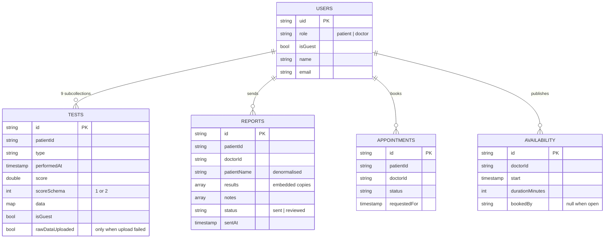

Test results live at `users/{uid}/{category}/{docId}` — one subcollection per
test type. The questionnaire is the exception: it keeps a **single document with
the fixed id `questionnaire`**, overwritten on each submission, since the UI only
ever renders the most recent answers.

### Two invariants that will bite you

**1. `score` has two incompatible conventions.** Read `concernScore`, never
`score` ([test_result.dart:16-78](lib/models/test_result.dart#L16-L78)).

Schema 1 documents stored a Parkinson's *likelihood* for the sensor tests but a
*performance* score for the MoCA and FAB batteries. A high value meant "bad" for
some rows and "good" for others — 80% is "well done" on the neuro test and "see a
doctor" on the camera test. Anything comparing, averaging or charting them
together was combining opposite quantities.

Schema 2 unifies the direction: **0 is the best possible outcome, 1 the most
concerning.** Old documents are not rewritten; `concernScore` converts them on
read, consulting
[`TestScoreInterpretation.directionOf`](lib/models/test_score_interpretation.dart).

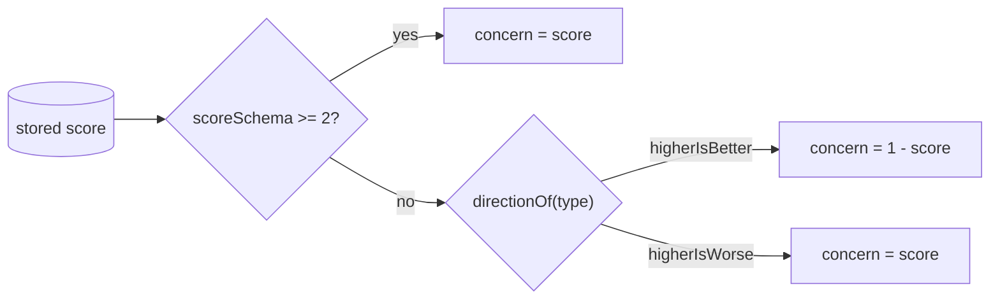

`higherIsBetter` covers `neuro`, `fab` and `posture` (20/20 is a perfect
performance). Everything else is `higherIsWorse`. Bands — `reassuring` /
`borderline` / `notable` — come from `bandOfConcern`, with per-type cut-offs;
all provisional, and the patient-facing wording is cautious as a result.

**2. `patientName` is denormalised onto the report.** The security rules give
each user access to their own profile only, so a doctor *cannot* resolve a
patient's name from `users/{uid}`. The patient is the one sending, so they supply
it ([reports_service.dart:25-41](lib/services/reports_service.dart#L25-L41)).

### One sharp edge

`TestResult._typeFromString` defaults **any unrecognised type string to
`cameraDetection`** ([test_result.dart:127-134](lib/models/test_result.dart#L127-L134)).
A *known* type missing from that switch therefore reads back as the wrong test
entirely rather than failing loudly — which is how posture results came to be
labelled as camera ones on both the patient's list and the doctor's report.

`TestService.fetchResultsForPatient` iterates all nine `TestType.values`,
swallowing permission errors per type, then sorts by date. `watchResultsForPatient`
fans out one snapshot listener per type into a single merged stream.

---

## 8. Security model

| Collection | Read | Create | Update | Delete |
|---|---|---|---|---|
| `users/{uid}` | Own profile, **or** any doc where `role == 'doctor'` | Own | Own | — |
| `users/{uid}/{category}/{docId}` | Own, and `category` in allowlist | Same | Same | — |
| `reports/{id}` | Patient or doctor on it | Patient only, `patientId == uid` | Patient or doctor | Never |
| `appointments/{id}` | Patient or doctor on it | Patient only | Patient or doctor | Never |
| `availability/{id}` | Open slots, or your own | Doctor, for themselves, unbooked | Doctor, or a valid booking/release | Doctor, unbooked only |

### Rules are not filters

The principle that shapes two queries in this codebase: **security rules decide
whether a query is *allowed*, not what it returns.** A query spanning documents
that are not provably readable is rejected outright rather than returning fewer
rows. So the constraint must appear in the query itself:

- `ReportsService.fetchAllDoctors()` carries `.where('role', isEqualTo: 'doctor')`.
  Without it the doctor picker showed "no doctors found" however many existed.
- `AvailabilityService.watchOpenFor` carries `bookedBy == null`, which is what
  makes an open slot provably readable when browsing another doctor's calendar.

### Other decisions worth knowing

- **Doctor profiles are readable by any signed-in user.** Scoped to
  `role == 'doctor'` deliberately — a doctor document holds name, email,
  specialty and location, which is exactly the directory entry a patient chooses
  from. Patient documents stay private.
- **An availability slot is an offer, not a booking.** An open slot holds nothing
  about a patient. The moment one is taken, `bookedBy` is set and the read rule
  narrows to the two parties — which is what stops the collection leaking who is
  seeing which doctor. A booking must pin `doctorId`, `start` and
  `durationMinutes`, or a patient could take a slot and rewrite it into a
  different appointment.
- **Appointment status transitions are enforced in `AppointmentService`, not in
  rules.** A state machine in rules is a lot of complexity for a single trusted
  client, and would still need duplicating in Dart to produce a usable error.
  *If a second client is ever written against this data, revisit that trade-off.*
- **Nothing is ever deleted.** Reports and appointments deny delete outright; a
  booked slot can only be cancelled, because a patient is expecting that
  appointment and deleting the slot would take it away in silence.
- Storage caps: 10 MB PNG, 25 MB WAV, 20 MB gzip, with content types enforced.

---

## 9. Doctor and scheduling

Three services rather than one, split along how the data actually behaves:

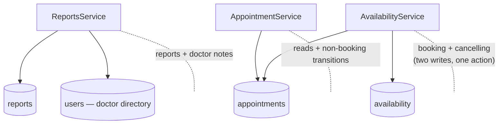

Booking and cancelling live in `AvailabilityService` rather than
`AppointmentService` because both also move a slot on the doctor's calendar, and
the two writes have to happen together. What is left in `AppointmentService`
reads appointments and answers requests written under the older flow.

`ReportsService` is kept separate from both so it does not become the place where
everything doctor-shaped ends up.

Booking failure is a named exception, not a bare `false`:
`SlotUnavailableException.taken()` ("someone else got there first") versus
`.withdrawn()` ("the doctor removed it"). The two read very differently to a
patient staring at a calendar, and both need saying out loud instead of the tap
appearing to do nothing.

[`report_analysis.dart`](lib/services/report_analysis.dart) computes
`AssessmentGap`s for the doctor's view — what is missing from a report and why
(`notTaken`, `nothingMeasured`, `partlyRecorded`, `lowQuality`). It carries
**numbers, not formatted sentences**, so the screen can say "3 of 10 items" in
the reader's own language. Building the sentence in the service is how the Greek
build ended up with English chart labels elsewhere in this app.

---

## 10. Design system and accessibility

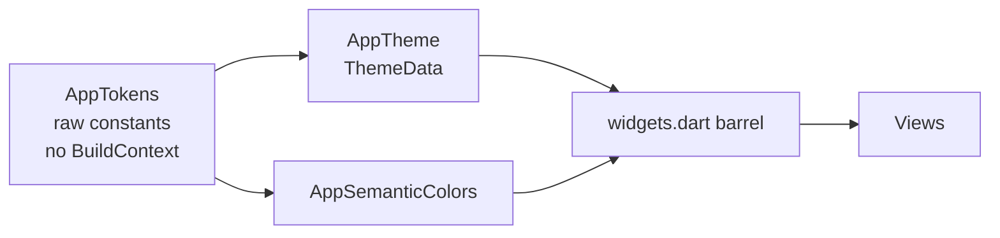

[`AppTokens`](lib/ui/common/app_tokens.dart) is deliberately free of `ThemeData`
and `BuildContext` so it can be imported anywhere, including painters and
services. In widgets, resolve colour through `Theme.of(context).colorScheme` and
spacing through `AppSpacing`; reach for the raw constants only for
fixed-contract colours or when building a `ThemeData`.

Import the [barrel](lib/ui/common/widgets/widgets.dart), not the individual
files — a view should carry one import for the design system, not eight. The
rule for everything in it: **presentation only.** No state, no service calls.

Contrast is documented per token, and the distinction is load-bearing: `outline`
(5.2:1) is safe for interactive borders, `outlineVariant` (1.6:1) is decorative
hairlines only and must never carry one. `warning` at 3.7:1 works as a fill, icon
or border but never as body text — use `AppSemanticColors.warningContainer`
behind text instead.

### Accessibility is a design constraint here, not a feature

The audience has hand tremor, so:

- **Text size uses four discrete presets** (1.0 / 1.15 / 1.3 / 1.5), not a
  slider. A slider needs a sustained precise drag — the worst possible control
  for a tremulous hand. Four fixed options are one tap each, and a mis-tap lands
  on a neighbouring size rather than somewhere wild.
- **Never below 1.0.** This audience should not be able to shrink text. Above
  ~1.5 the app's remaining fixed-height constructs break rather than reflow.
- **Scoped per uid**, not per device. The app runs on shared clinic tablets: with
  a single device-wide key, a doctor who set the largest size handed it to
  whoever signed in next, with nothing in the UI explaining why. Signing out
  drops back to the device default, which the sign-in screen can set — a tablet
  in a waiting room can be left comfortable once and inherited by everyone.
- **`tabBarTextScaler` has its own ceiling**, because Flutter sizes a tab bar
  with icon and text from a compile-time constant that does not grow with the
  text scaler, and both tab bars here run with `toolbarHeight: 0` — the tab bar
  *is* the app bar.

### Localisation

English and Greek, fully. Sources are `.arb` files in [`lib/l10n/`](lib/l10n/);
`app_localizations*.dart` are **generated** — edit the `.arb`, then:

```bash
flutter gen-l10n
```

Config lives in [`l10n.yaml`](l10n.yaml) (template `app_en.arb`). Never build a
user-facing sentence inside a service.

---

## 11. Testing, and how to add a test type

### Test layout

```
test/
├── helpers/            test_helpers.dart + generated mockito mocks
├── models/             serialisation, validation, score direction
├── services/           each service, plus synthetic_hand.dart
│   └── scoring/        scorers, cycle analyzer, quality
│                       + synthetic_recording.dart
├── viewmodels/         camera, doctor, login, patience, dialogs
└── ui/                 scaffold, component library, text scale
```

The **synthetic fixtures** are the key enabler:
`test/services/synthetic_hand.dart` and
`test/services/scoring/synthetic_recording.dart` construct landmark input
directly, so a scorer can be tested without a camera, a device or a recording
session. This is what the `RecordedTask` / `CameraTaskSegment` split buys.

```bash
flutter test              # all
flutter analyze           # lints
```

### Adding a new test type — checklist

Nine steps, in order. Steps 4 and 5 are the ones that fail *silently*.

1. Add the enum value to [`test_type.dart`](lib/models/test_type.dart).
2. Add cases to `_typeToPath`, `_typeToLabel` and `_uploadRawData` in
   [`test_service.dart`](lib/services/test_service.dart) — all three switches are
   exhaustive, so the compiler will find them.
3. Add the string to `TestResult._typeFromString`
   ([test_result.dart](lib/models/test_result.dart)). **Missing this does not
   fail to compile** — results read back as `cameraDetection`.
4. Add the category to the `category in [...]` allowlist in
   [`firestore.rules`](firestore.rules), **matching case exactly**. Missing this
   denies every write silently.
5. Add the Storage category to [`storage.rules`](storage.rules) if the test
   uploads a raw asset. Remember Storage uses `TestType.name`, not the Firestore
   path.
6. Add a direction to
   [`TestScoreInterpretation.directionOf`](lib/models/test_score_interpretation.dart)
   and a band to `bandOfConcern`. Write new results with `scoreSchema: 2`.
7. Register the View in `@StackedApp.routes` in [`app.dart`](lib/app/app.dart),
   then run build_runner.
8. Add labels to **both** `.arb` files and to
   [`test_type_labels.dart`](lib/ui/common/test_type_labels.dart), then
   `flutter gen-l10n`.
9. Add icon, label and navigation to
   [`test_catalogue.dart`](lib/ui/views/patience_view/test_catalogue.dart).

Step 9 is designed to help you: `TestPresentation` hangs off the enum, so a new
test type is a **compile error** there rather than a screen that silently falls
through to the camera test — which is what the previous inline `if/else` chain's
`else` branch did.

### Where the ML models come from

[`Parkinsons_ML/`](Parkinsons_ML/) holds the Python training side for the tapping
model — `train_model.py`, `train_tensorflow_model.py`, `convert_to_tflite.py`,
plus the dataset and `.h5`/`.pkl` artifacts. The `.tflite` outputs are committed
under `assets/models/` and declared in `pubspec.yaml`. `voice_norm.json` carries
the training means and standard deviations, and `VoicePredictor` must normalise
with exactly those values or inference is meaningless.
